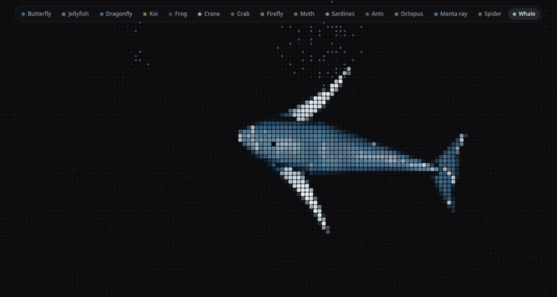
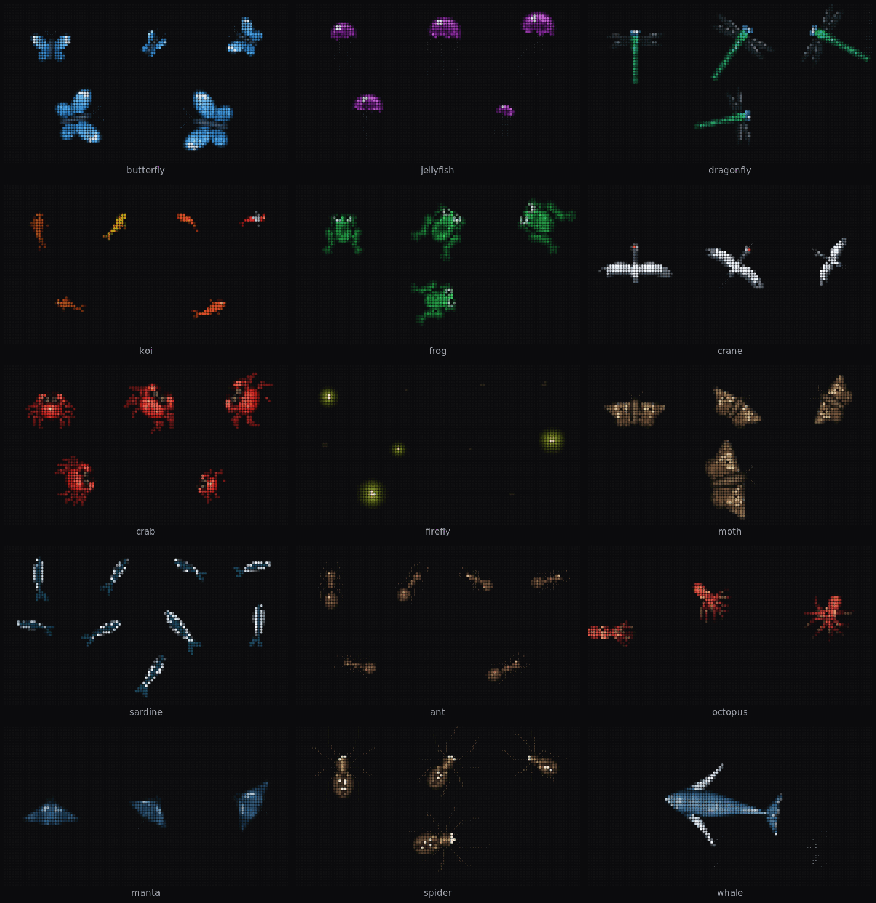
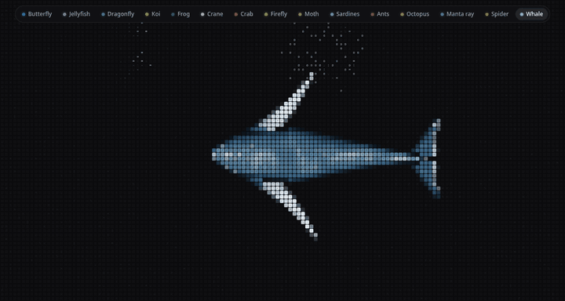
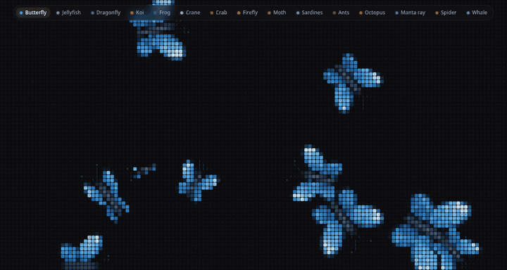
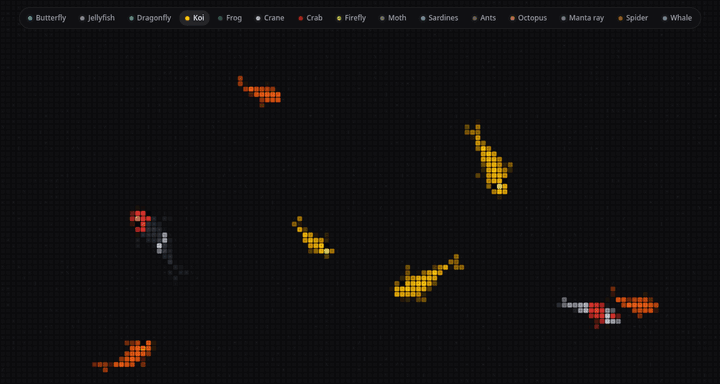
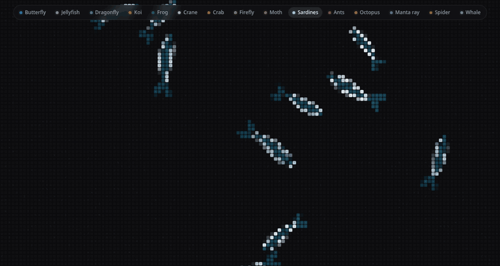
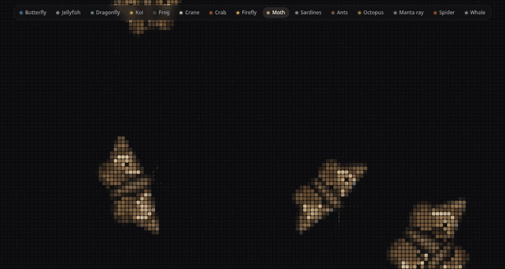
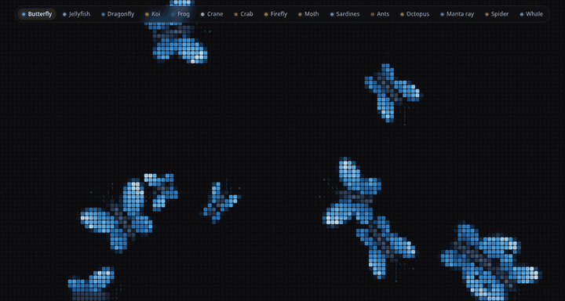

# ASCII Animals

A living background for a hero section: fifteen animals drawn one character cell at a time on a single canvas. They swim, fly, crawl and react when you click. Pick an animal from the bar at the top and the current ones fly off while the new ones arrive.



Videos (WebM, open in a browser):

- [Tour of the animals](docs/media/tour.webm): switching through the bar with clicks along the way, 55 seconds.
- [The whale](docs/media/whale.webm): a spout, a breach, a dive with the flukes raised, and resurfacing, 28 seconds.

## Highlights

- Fifteen animals, each with its own shape, motion and reaction to a click.
- No sprites and no images. Every animal is a set of shapes evaluated per cell, shaded from a small palette, so they turn, bend and flap smoothly at any size.
- One canvas, zero runtime dependencies, about 12 KB gzipped for the core. Each animal is its own small chunk that loads only when chosen.
- An animal switcher bar with keyboard support, and your last choice is remembered.
- Pauses when off screen or in a background tab. Shows a single still frame for people who prefer reduced motion.



## The animals

| Animal | How it lives | When you click |
| :-- | :-- | :-- |
| Butterfly | Flutters on a wandering path, wings beating | Scatters away from the click |
| Jellyfish | Pulses upward and drifts, tentacles trailing and leaving a faint glow | Scatters, tentacles streaming behind |
| Dragonfly | Hovers, then darts, on translucent wings, leaving a trail | Darts away at high speed |
| Koi | Glides through the pond in several colour varieties | Drops food pellets that the fish race to eat |
| Frog | Sits, crouches, then hops in long arcs with its legs stretched back | Leaps away from the click |
| Crane | Flies in loose V flocks with slow, deep wingbeats | Scatters |
| Crab | Walks sideways on fanned legs | Raises its claws and scuttles off |
| Firefly | Blinks, and slowly falls into sync with its neighbours | Startled ones flash at once |
| Moth | Erratic, fluttering flight; circles the cursor like a lamp | Scatters |
| Sardines | Swim as a tight school with silver flanks flashing on the turns | Panic spreads through the school as a wave |
| Ants | March in two way columns along winding trails | Drops a crumb; the nearest ants fetch it and carry it home |
| Octopus | Crawls and drifts with curling arms | Flushes dark, jets away and leaves a cloud of ink |
| Manta ray | Glides on slow, rolling wingbeats | Beats harder and glides away |
| Spider | Walks in quick dashes, or hangs on a silk thread from the top | Walkers bolt; hangers climb back up their thread |
| Whale | Lives a full breathing cycle (see below) | Breaches |

Sizes vary within each species, so a group never looks stamped out of one mould.

### The whale

The whale is the showpiece, a single humpback roughly 85 cells long on a desktop screen.

- It cruises at the surface, pushing a bow wave and a spreading wake and leaving flat prints behind each stroke of its tail. Sunlight ripples across its back.
- It spouts two to four times, then dives: the head tips down first, then the flukes lift clear of the water and show their pale underside before sliding under.
- While deep it is dim and smaller, trailing bubbles that swell and pop on the way up. It surfaces with one big breath.
- Its body arcs into turns, its long white flippers sweep, and every so often it raises a flipper and slaps it down.
- Click the whale and it breaches: it surges toward you, rolls to show its grooved white throat, spreads its flippers, and crashes back in a ring of spray. Click the water and it turns to come and look.



## More in motion

| | |
| :-: | :-: |
|  |  |
| Switching from the bar: the old animals leave, the new ones glide in | Koi racing for food pellets |
|  |  |
| A panic wave through a sardine school | Moths circling the cursor |
|  | |
| Butterflies scattering from a click | |

## Quick start

Requires Node 18 or newer.

```sh
npm install
npm run dev
```

Open the address Vite prints (by default http://localhost:5173). Use the bar at the top to change animals and click anywhere to interact.

The demo page accepts a few URL parameters, handy for screenshots and testing:

| Parameter | Effect |
| :-- | :-- |
| `animal=whale` | Start with this animal (and do not remember the choice) |
| `seed=4` | Fixed random seed, for repeatable scenes |
| `count=6` | Fixed number of animals instead of the size based count |
| `cell=12` | Cell size in CSS pixels |
| `t=4` | Simulate 4 seconds and show one still frame |
| `debug` | Show frame time, animal count and grid size |

## Using it on a page

Build the library, then import it.

```sh
npm run build:lib    # writes dist/ascii-field.js plus one small chunk per animal
```

```html
<section id="hero" style="position: relative; height: 100vh">
  <h1 data-af-dim>Your name</h1>
</section>

<script type="module">
  import { createAsciiField } from './dist/ascii-field.js';

  const field = createAsciiField({
    host: document.getElementById('hero'),
    animal: 'whale',
  });
</script>
```

The canvas fills the host element, which must be positioned. Clicks on links, buttons, form fields and the switcher bar are ignored, so the page stays usable. Any element marked `data-af-dim` gets a soft dark halo behind it, keeping text readable over the animals.

### Options

| Option | Default | Description |
| :-- | :-- | :-- |
| `host` | required | The element to cover. It receives the clicks. |
| `animal` | last choice, or `'butterfly'` | Starting animal: `butterfly`, `jellyfish`, `dragonfly`, `koi`, `frog`, `crane`, `crab`, `firefly`, `moth`, `sardine`, `ant`, `octopus`, `manta`, `spider`, `whale`. |
| `theme` | `'dark'` | Background theme, `'dark'` or `'light'`. |
| `ui.switcher` | `'top'` | Where the animal bar goes: `'top'`, `'bottom'` or `false` for none. |
| `tweaks` | see below | Initial tweak values. |
| `persist` | `true` | Remember the chosen animal in local storage. |
| `dimSelector` | `'[data-af-dim]'` | Which elements get the readability halo. |
| `seed` | `7` | Random seed. |
| `debug` | `false` | Show the debug readout. |

Tweaks:

| Tweak | Default | Range | Description |
| :-- | :-- | :-- | :-- |
| `density` | `1` | 0.25 to 2 | Multiplier on the number of animals. |
| `speed` | `1` | 0.25 to 2 | Global speed multiplier. |
| `cellSize` | `9` | 6 to 16 | Size of one character cell in CSS pixels. |
| `bgDensity` | `0.32` | 0 to 1 | How many background cells carry a faint glyph. |
| `trails` | `true` | | Trails behind dragonflies and jellyfish. |

### Methods

```ts
field.setAnimal('koi');            // switch, with the fly out / fly in transition
field.setTweaks({ speed: 1.5 });   // change tweaks live
field.pause();
field.resume();
field.destroy();                   // removes the canvas, the bar and every listener
```

## How it works

The screen is a grid of character cells. Each frame:

1. Every animal is simulated in plain 2D: steering, flocking and schooling, wandering noise, panic that fades after a click, and per species behaviour such as the whale's dive cycle or the ants' trails.
2. Every animal is rendered in its own local space. For each cell it covers, the renderer measures distance to a few simple shapes (ellipses, capsules, triangles) and turns that into coverage and a shade: soft edges, rim darkening, mottling, highlights. Thin parts such as antennae, legs and silk are drawn as line characters (`/ \ | - .`) instead of filled tiles.
3. The cells go into a buffer where nearer parts win, then onto the canvas from a pre rendered atlas of shaded tiles: one `drawImage` per occupied cell.

Since nothing is a bitmap, animals can turn, bend, flap and change size freely and still land cleanly on the grid.

## Accessibility and performance

- The canvas is decorative and hidden from screen readers.
- The animal bar is a radio group: Tab reaches it, the arrow keys, Home and End move between animals, and it is a single tab stop.
- With `prefers-reduced-motion`, the animals are simulated for a moment and shown as a single still frame, with no animation loop.
- The loop stops when the hero scrolls out of view or the tab is hidden.
- Animal code is lazy loaded: the page downloads only the animals that are actually shown.

## Project layout

```
src/
  index.ts          createAsciiField: setup, loop, observers, public API
  engine/           grid, cell buffer, atlas, shapes, palettes, world simulation, input
  animals/          one file per animal, plus the lazy registry
  ui/               switcher bar, styles, debug overlay
  persist.ts        remembers the chosen animal
test/               unit tests (Vitest)
scripts/            screenshot helper and an ASCII dump of a single animal
docs/media/         the images and videos in this README
```

## Development

```sh
npm test             # unit tests
npm run typecheck    # TypeScript, strict
npm run build        # demo build
npm run build:lib    # library build into dist/
node scripts/shot.mjs http://localhost:5173/ qa/whale "animal=whale&t=4"   # screenshots (Playwright)
```

To print one animal as text in the terminal, which helps when shaping a new one:

```sh
npx vite-node scripts/ascii-dump.ts whale
```

### Adding an animal

Create `src/animals/<name>.ts` exporting an `AnimalDef` with its palettes, a `spawn`, an `update` and a `render`. Then add it to the id list in `src/types.ts`, the registry in `src/animals/registry.ts` and the list in `src/animals/all.ts`. The shared tests check that every animal simulates without errors, reacts to clicks and spawns spread out.
